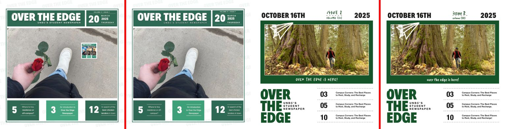
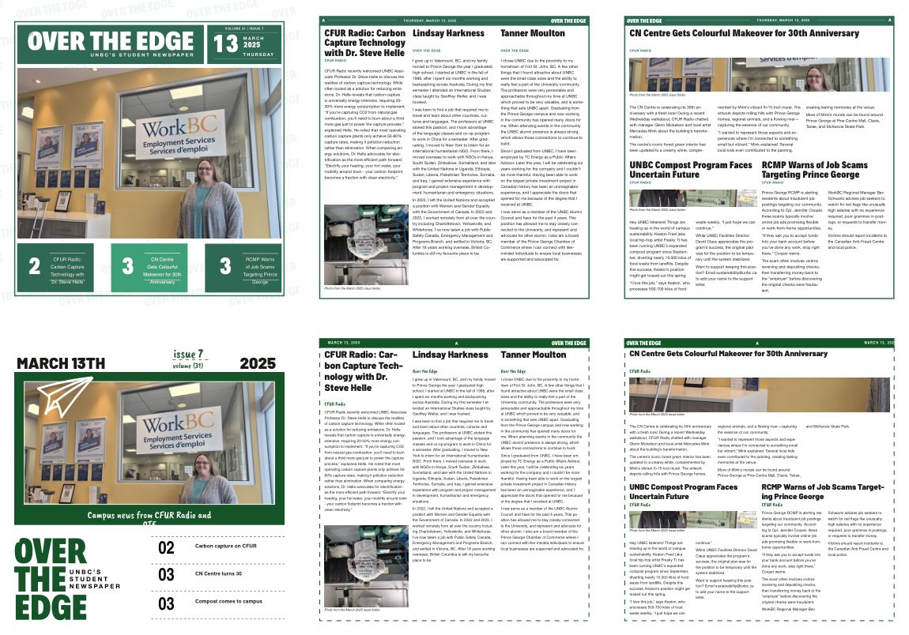
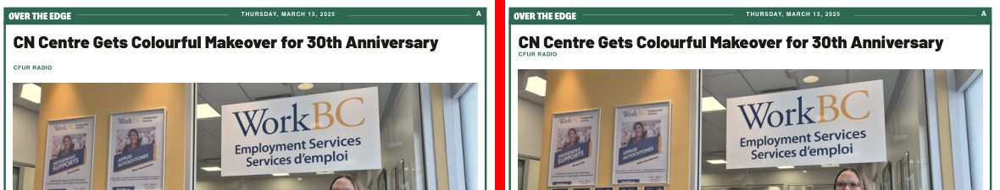

# The original OTE designs as templates

OTEManager can now lay out an issue in the two house designs the paper actually printed, recreated from the source InDesign files on the Drive, in addition to the 104 reconstructed recipes:

| Design | Source | Look |
|---|---|---|
| **OTE 2024–25** (`ote-2024`) | Issue 7, March 2025 (`Fall 2024- Winter 2025/Issue 7 March 2025/…idml`) | Green header bar with section letter and dateline, solid frame, masthead cover with numbered feature boxes |
| **OTE 2025–26** (`ote-2025`) | Issue 2, October 2025 (`2025-2026 Ahmad's Version/Issue 2/…idml`) | Dark green header bar, dashed frame, framed-photo cover with handwritten issue line and numbered feature list |

Each design has a cover and a version of all 76 story recipes, so 258 templates ship in `public/designcraft/templates.json`. Variants, whole-issue plans, the browser composer and the server all work with them. Pick a design under **Design** in the template catalogue, open one of its recipes in the planner, or choose **House design for suggested plans** in *Compose in this browser*.



## How a design is built

`tools/designcraft/build-original-templates.mjs` reads the original IDML with DesignCraft 0.9.0 and writes:

- **Design layers** (`public/designcraft/original-art/*.designcraft`): the header, frame, masthead, rules and cover artwork as DesignCraft snippets, per side (left page, right page, cover), plus an `over` layer for artwork stacked above the cover photo (the 2025 paper plane). Each layer comes in two versions: original fonts, and *portable* (fonts replaced by open look-alikes). The source quirks are handled at build time:
  - InDesign's default "Dashed" stroke has no dash pattern of its own, so the 2025 frame gets an explicit 6× weight pattern (12.1/12.1 pt at 2 pt, as measured in the original PDF).
  - Embedded EPS artwork is converted to PDF with Ghostscript and embedded again.
  - Right-hand pages are moved into page coordinates.
- **House styles** (`library.designs[id].styles`): headline, body, byline and caption typography and swatches, captured from the stories themselves.
- **Field slots** for everything issue-specific, as `text` slots with the captured style and a format:
  - dateline: `{WEEKDAY}, {MONTH} {D}, {YYYY}` (2024) or `{MONTH} {D}, {YYYY}` (2025);
  - cover date, year, issue and volume lines;
  - cover line;
  - feature titles;
  - feature numbers.

  Feature numbers are live page cross-references in the native document (`3` in 2024, `03` in 2025), so moving a page renumbers the cover.
- **Story recipes**: each classic recipe mapped into the design's content box, with the dateline on the correct side and no folio (the originals have none; the header letter is a section label).

Rebuild after changing the source or the rules:

```sh
node tools/designcraft/build-original-templates.mjs --source /path/to/extracted/drive \
  --cli /path/to/designcraft-cli-0.9.0 --fonts /path/to/private/original-fonts
```

Restore the classic-only `templates.json` first if you rebuild from scratch; the builder is deterministic (rerunning it changes only what its rules changed).

## Fonts

| Original | Used for | Open substitute (portable builds) |
|---|---|---|
| Decalotype Black / Bold / Medium | Masthead, headlines, cover numbers | Barlow Black / ExtraBold / SemiBold |
| Helvetica Neue (and Condensed) | Body, bylines, datelines | TeX Gyre Heros (Cn Bold) |
| Salted, Wordy Diva | 2025 handwriting (issue line, cover line, bylines) | Caveat Brush |
| Kefa | Odd labels | TeX Gyre Heros |
| Minion Pro | Captions in some art | Source Serif 4 |

The substitutes (OFL/GUST-licensed) are committed in `public/designcraft/assets/fonts/` and packaged only into design builds, so classic output is unchanged. The originals are licensed and stay private:

- On the server, use `DESIGNCRAFT_ORIGINAL_FONT_DIR`.
- In the browser composer and the web editor, choose the font files; they stay on the device.

When an original-font build lacks a face, the compiler notices (it reads the supplied fonts' name tables), uses that face's substitute and records it in the manifest as `substitutedFonts` instead of failing.

Captured source fields can define a scoped substitute in `style.portable`, with `fontFamily`, `fontStyle` and optional `chars.hScale`. Horizontal scale is a finite fraction from 0.25 to 4; it lets a substitute match the source text's measured width without removing copy. These character overrides apply whenever the substitute is selected, including a missing-face fallback in an original-font build. Supplying the original face restores its captured character attributes. Native and IDML exports retain the selected scale.

**Salted.** The supplied `salted-regular.otf` (The Type Founders) is licensed *for personal use only, no redistribution*, so it is not in the repository. Put it in the private font directory with the other originals. With it installed, the 2025–26 cover matches glyph for glyph.

## Fidelity

Recreated pages compared with the original InDesign PDFs, on the same page scale (1 = identical pixels):

| Page | Original fonts | Portable |
|---|---|---|
| 2024–25 cover | 0.978 | 0.969 |
| 2024–25 interior (left / right) | 0.999 / 0.999 | 0.999 / 0.999 |
| 2025–26 cover | 0.980 with Salted (0.979 without) | 0.945 |
| 2025–26 interior (left / right) | 0.993 / 0.993 | 0.993 / 0.993 |

The remaining cover difference is issue content (the March 2025 inset sticker is not part of the design layer) and, for portable builds, the substitute faces. Evidence: [`designcraft-review/originals-check.json`](designcraft-review/originals-check.json).

## Real articles

The six March 2025 articles plan and compile in both designs, from the CLI, from Node with WebAssembly, and from the browser:

- **OTE 2024–25:** 3–4 pages, 0 preflight errors, cover references `2/3/3`.
- **OTE 2025–26:** 3–4 pages, 0 errors, `02/03/03`.

Long full headlines on the covers step down 0.5 pt at a time until they fit, never below 60%, and the steps are recorded as `coverTitleFit`. Turn this off with *Step long cover titles down to fit*, or enter short cover titles (the originals used teasers) under **Short cover titles**.



## Headline bands that fit the headline

The reconstructed recipes reserve a fixed headline band, so a short headline left a gap above the byline and a long one oversets. Bands now fit the headline both ways (`compiler/fit.js`):

- **Too long:** the band grows; the byline and photo move down and the body starts lower (this fixed the 57-character CFUR title in half-width recipes).
- **Fewer lines than the band** (e.g. one line): with *Fit headline bands* on, the band shrinks, the byline moves up under the headline, and the **photo's top edge rises so the image grows** into the freed space. A column with no photo gives the space to the body instead. Folios, datelines and other stories never move.



The engine measures every band and native preflight checks every fitted layout. In the planner, **Fit headline bands live (Pretext)** shows the fitted page instantly while you pick recipes and articles. It uses [Pretext](https://github.com/chenglou/pretext) 0.0.9 (vendored in `assets/pretext/`), which measures text with the browser's own font engine and the same open faces. **Keep the fitted layout** applies it; generating checks it in the engine.

Pretext and the engine agreed on the line count of every headline tested: 468 real March 2025 headlines across all 228 story recipes, and 1,404 more title prefixes chosen to land near line breaks. In the live check, Pretext's fitted band (−19.4 pt) matched the engine's (−19.37 pt). Pretext took 0.25–0.7 s for the whole set against 1.5–3.5 s in the engine. Rerun with `tools/designcraft/check-pretext-fit.mjs`. Evidence: [`designcraft-review/pretext-fit-check.json`](designcraft-review/pretext-fit-check.json).

## Photo focal points

Click or drag on a photo in the page editor to set the point that must stay in view (as in WordPress), and use **Zoom** (100–300%) to crop tighter. Previews show the crop in this frame, a square and a tall frame. An article photo's focal point and zoom are saved with the photo itself, so every recipe, variant and fitted band keeps that part in view. A frame's own focus still wins. Both compilers (JavaScript and Python) apply them identically.

## Print and InDesign checks

- `tools/designcraft/check-print.py output.pdf --baseline accepted/*.pdf` profiles PDFs and compares them with the PDFs the printer took. The files sent to the Prince George Citizen are plain PDF 1.4, RGB, 756×792 pt, trim = page, no bleed, every font embedded, images down to 64 ppi. Every generated issue passes; ours are stricter (PDF/X-4 with an output intent).
- `tools/designcraft/check-idml.py output.idml --baseline original.idml` checks IDML structure against InDesign's own files:
  - the mimetype entry;
  - well-formed XML;
  - designmap parts;
  - story/frame links;
  - style, swatch and font references;
  - page geometry.

  All generated IDMLs pass. They declare DOM 16.0 (InDesign opens older IDML and converts it), against 20.x in the originals.
- Every generated IDML also reopens in DesignCraft 0.9.0 with every story's text intact.

Not verified here, because neither is available in this environment: opening the IDML in Adobe InDesign, and a physical press proof.

## Compiling outside the server

The Python compilers decline design templates. Use the JavaScript compiler:

```sh
node tools/designcraft/compile.mjs --library templates.json --issue issue.json --output out \
  [--font-dir private-fonts --font-profile original2025] [--cli /path/to/designcraft-cli] [--booklet]
```

Without `--cli` it uses the committed WebAssembly engine. Design recipes exported from the planner include the design layers they need.
