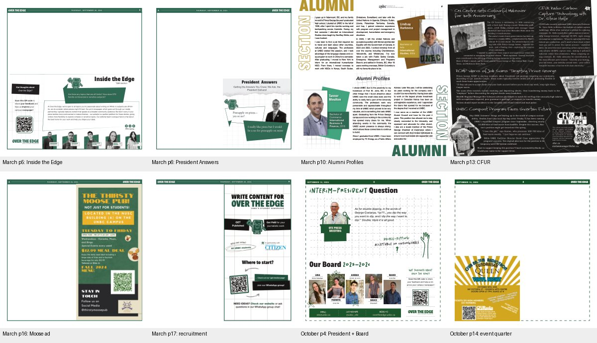

# OTE source PDF layout audit

Audited October 22, 2026. All **12 unique original PDFs (156 pages)** in `public/designcraft/originals/` were checked against the SHA-256 values and source archive paths in `documents.json`. Every page was visually reviewed in contact sheets; text and image bounds were read with PyMuPDF. The machine-readable checksum record is [source-pdf-audit.json](source-pdf-audit.json).

The source archive is the linked `OneDrive_2026-10-09.zip`. These PDFs are **working layout templates, with many blank article areas**, not complete records of all printed articles. Do not fill their blank areas with invented source articles or describe reconstructed story recipes as exact reproductions of articles absent from these PDFs. The source IDML and article records supply additional story text separately.

The [source issue maps](../../public/designcraft/source-issue-maps.json) record the complete physical page sequence of all nine issue PDFs: **153 issue pages**, plus the three standalone asset pages above. Every local issue PDF page is already 756 × 792 pt; none requires wide-page splitting. Four continuous photo-feature spreads are linked across their adjacent pages. Unknown actual publication dates remain null, with stale cover metadata recorded separately. Map `pdf` paths point to the hash-verified originals; `readingPdf` paths point to the catalogue's sometimes optimized reading copies.

The maps also define **22 advertising spots**: 21 supplied raster creatives measured directly from their PDF image bounds, plus the unfilled gray crossed reservation on September 2025 p17 measured from its outer source frame. Full-page recruitment creatives in the November/December versions and right-half creatives in February/March remain distinct placements.

## Coordinate convention

All issue pages are **756 × 792 pt**. Pages below are **one-based physical PDF page indices**, not inferred printed folios. Rectangles use `[left, top, right, bottom]` in points, the same convention as `templates.json`. A measured image bounding box is exact to the shown precision; a whole-section crop is an enclosing region and is identified as such.

## Recurring sections and ad positions

| Piece | Source | Rectangle | Interpretation |
|---|---|---|---|
| Inside the Edge | March 2025 p5 | `[39,374,717,759]` | Bottom half, enclosing section region. Heading, question, answer, feedback QR panel and five-person board strip. Keep the upper half available for an article. |
| President Answers | March 2025 p6 | `[374.699,400,717.664,757.440]` | Exact background image bounds: bottom-right quarter, with portrait and independently editable question and answer. |
| Alumni Profiles | March 2025 p10 | `[0,0,756,792]` | Full-page designed contribution with two profiles and two portraits. Several original text/art bounds extend beyond trim; preserve page clipping. |
| CFUR editorial contribution | March 2025 p13 | `[0,0,756,792]` | Full-page contribution, four short news stories, three photos, radio branding, attribution and contact panel. This is editorial content, not an advertising reservation. |
| Thirsty Moose Pub | March 2025 p16 | `[386.601,65.249,716.849,752.743]` | Exact creative image bounds: right half below the header. Left half remains available. |
| OTE recruitment | March 2025 p17 | `[378.383,64.185,718.898,755.940]` | Exact creative image bounds: right half. Earlier versions instead use the full page; do not treat this as one invariant size. |
| Interim-President Question | October 2025 p4 | `[54.622,69.390,676.838,439]` | Enclosing upper section, above the board. Different design from 2024–25 President Answers. |
| Our Board 2025–2026 | October 2025 p4 | `[53.567,446.614,687.308,740]` | Enclosing lower section: five portraits, names and roles; feedback/QR panel to right; email, Instagram and website beneath. |
| CFUR event ad | October 2025 p14 | `[34.954,428.098,365.221,756.940]` | Exact creative image bounds: bottom-left quarter, advertising the CFUR 88.7FM Radiothon Fundraiser Queen Vinyl Night, October 18, 2025 at Omineca Arts Centre. |
| Thirsty Moose Pub | October 2025 p15 | `[386.348,65.249,716.849,752.360]` | Exact creative image bounds: right half. |
| OTE recruitment | October 2025 p16 | `[380.880,65.249,717.356,754.920]` | Exact creative image bounds: right half. |

References: [March original](../../public/designcraft/originals/issue-7-march-2025-dfcbb959.pdf), [October original](../../public/designcraft/originals/issue-2-october-2025-0eb630f7.pdf). These placements document the supplied issues, not a rule that every future issue must have the same length or sequence.

### President question of the month

The 2024–25 PDF calls the piece **President Answers**. The March and current February versions ask “Pineapple on pizza—yes or no?”; the answer says the president enjoys pizza but would not choose pineapple. November's version asks about horoscopes; December and archived February ask about a go-to karaoke song; Issue 5 asks “Trucks or Sedans?” and leaves the visible answer panel blank. These variations establish separate question and answer inputs, rather than a single decorative text placeholder.

For the March p6 design, measured text/image rectangles are:

| Editable element | Rectangle |
|---|---|
| Heading | `[467.901,401.829,647.731,429.209]` |
| Subtitle | `[426.769,425.829,667.666,465.517]` |
| Question | `[423.360,560.801,549.419,599.036]` |
| Answer | `[498.960,633.270,677.967,671.505]` |
| Portrait | `[584.367,498.969,707.412,623.076]` |

The October 2025 p4 piece instead says **Interim-President Question**, with a large portrait/podium to the left, answer toward the upper right and a handwritten question below. Its topic is double-dipping. The question bounds are `[384.365,324.163,617.337,422.414]` including its separate question mark, and the answer bounds are `[285.323,177.572,553.905,255.379]`. A preset should preserve these designs as separate choices and keep editable fields clearly named.

### Source dates and section markers

The March interior headers still read **Thursday, September 26, 2024**. October headers alternate September 12, 2024 and September 12, 2025 even though the cover says October 16, 2025. Several cover cards repeat old teaser titles, and Issue 5/February cover volume and issue labels are stale. Treat these as source-template residue. Production output must take dates, volume, issue and cover references from the selected issue.

The repeated **A** in the header is a literal section marker, not evidence for a named category such as News, Arts or Opinion. Verified recurring named sections are Inside the Edge, President Answers / Interim-President Question, Our Board, Alumni Profiles, CFUR, Wildlife Photo Contest, Winter Photo Contest and Campus Corners. Ad brands are ad identities rather than editorial section names.

## Complete PDF inventory

| PDF | Pages | Visible fixed content and differences |
|---|---:|---|
| `cover-page-issue-3-lina-6dd82589.pdf` | 17 | November cover; p5 board strip along bottom; p6 President Answers; p13 CFUR promo in bottom-right quarter; p16 Moose right-half ad; p17 full-page OTE recruitment. Most other interiors are blank branded templates. |
| `cover-page-issue-3-lina-de16e159.pdf` | 17 | December print-archive path, but cover still uses November 14 and has an unfilled gray crossed photo frame; p6 horoscope President Answers; p9 Wildlife Society logo; p13 CFUR quarter promo; p16 Moose; p17 full-page recruitment. This is visibly incomplete. |
| `cover-page-issue-3-lina-2dc29f52.pdf` | 17 | December final-layout path: Christmas cover photo; p6 karaoke President Answers; p8–9 Wildlife Photo Contest winners spread; p13 CFUR quarter promo; p16 Moose; p17 full-page recruitment. |
| `issue-5-ba123d17.pdf` | 17 | Fireworks cover with stale December 5 cover labels; p5 Inside the Edge; p6 Trucks or Sedans President Answers with blank answer; p13 CFUR quarter promo; p16 Moose; p17 empty beneath its header. |
| `issue-6-feb-2025-b91aa3a0.pdf` | 17 | Archived revision reuses Christmas cover; p5 Inside the Edge; p6 karaoke President Answers; p8–9 Wildlife Contest spread; p10 handwriting tests saying Ahmad; p13 CFUR draft with placeholder text; p16 Moose; p17 right-half recruitment. |
| `issue-6-feb-2025-5ed75bab.pdf` | 17 | Current February cover; p5 Inside the Edge; p6 pineapple President Answers; p8–9 Winter Photo Contest spread; p13 completed CFUR editorial contribution; p16 Moose; p17 right-half recruitment. |
| `issue-7-march-2025-dfcbb959.pdf` | 17 | March cover; p5 Inside the Edge; p6 pineapple President Answers; p10 Alumni Profiles; p13 CFUR editorial contribution; p16 Moose; p17 right-half recruitment. Pages 2–4, 7–9, 11–12, 14–15 are blank within branded headers/frames. |
| `issue-1-sept-2025-741805e9.pdf` | 18 | New dashed-frame cover/design; p4 lower Our Board/feedback panel, upper part unfinished; p11 fully blank; p12–13 Campus Corners photo spread; p17 right-half gray crossed reserved frame; p18 right-half recruitment. A gray reserved frame is not proof of a supplied paid ad. |
| `issue-2-october-2025-0eb630f7.pdf` | 16 | New cover/design; p4 Interim-President Question plus Our Board; p11 fully blank; p14 bottom-left event ad; p15 Moose right-half ad; p16 recruitment right-half ad. Most other interiors are blank within branded headers/frames. |
| `greatwhite-36b7e6a0.pdf` | 1 | Standalone Great White toys/comics/games creative, 684 × 345.6 pt. Its existence does not establish its placement in these issue PDFs. |
| `uride-x-citizen-unbc-23a7e247.pdf` | 1 | Standalone Uride creative, approximately 334.490 × 345.695 pt. Its existence does not establish an issue/page booking. |
| `logo-052e0d08.pdf` | 1 | Prince George Citizen logo artwork, 792 × 612 pt. It is an asset, not an ad booking or editorial page. |

## Gaps found in the initial editor/catalogue

The initial `piece-president-qa` recipe was a single box at `[36,100,720,360]` with placeholder question and answer fields; it did not match either source placement. The initial `piece-board-members` used that same generic box rather than the source lower section. Generic ad recipes reserved rectangles but did not identify which source creative/issue/page justified a position. The two house designs covered story and cover recipes, while fixed recurring pieces required their own source-derived recipes and bindings.

Useful completion criteria are: source-linked presets with measured reservations; editable question and answer fields whose exports contain the entered text; independent per-page ad/portrait bindings; preservation of artwork under source-fidelity options; issue-level placement of recurring sections; and a clear distinction between editable source text and a placed full-page contribution. Rasterized or placed source artwork can preserve appearance but does not by itself recreate editable articles.
